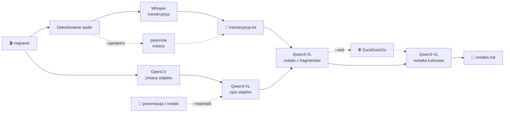

# 🎙️ transcriber

**Lokalna transkrypcja wykładów i nagrań po polsku, z wyciąganiem slajdów, podziałem na mówców i gotową notatką do nauki.**

Wszystko działa na Twoim komputerze, w czystym Pythonie. Nie potrzebujesz chmury, kont, tokenów ani dodatkowych programów. To jeden plik `transcriber.py`, a modele pobierają się same przy pierwszym użyciu.

```
━━━ [1/1] wyklad_04.mp4 ━━━
[  OK  ] [1/10] Dekodowanie audio (6s) — 1h 31m nagrania
[  OK  ] [2/10] Transkrypcja (Whisper large-v3-turbo, mps) (9m 48s) — 1412 segmentów
[  OK  ] [3/10] Zapis transkrypcji (0s) — wyklad_04_wyniki/wyklad_04_transkrypcja.txt
           pominięto powroty do wcześniejszych slajdów: 4
[  OK  ] [4/10] Wydobywanie klatek slajdów (2m 11s) — 31 unikalnych slajdów → slajdy/
[  OK  ] [5/10] Ładowanie modelu Qwen3-VL (12s) — Qwen3-VL-8B-Instruct-4bit (mlx)
[  OK  ] [6/10] Opisywanie slajdów (6m 20s) — 31 opisów
[  OK  ] [7/10] Przekazywanie transkrypcji i slajdów do modelu (7m 02s) — 6 fragmentów przeanalizowanych
[  OK  ] [8/10] Wyszukiwanie w internecie (41s) — 6 zapytań, 15 źródeł
[  OK  ] [9/10] Generowanie podsumowania (2m 15s) — 2140 słów
[  OK  ] [10/10] Zapis notatki (0s) — wyklad_04_wyniki/wyklad_04_notatka.md
```
<sub>Czasy przykładowe. Zależą od sprzętu i długości nagrania.</sub>

---

## ✨ Funkcje

| | |
|---|---|
| 📝 **Transkrypcja** | Whisper `large-v3-turbo` (domyślnie) lub `large-v3`. Timestampy jak w napisach. |
| 🖼️ **Slajdy** `--extract` | Zapisuje slajd tylko przy istotnej zmianie treści. Kamerka, gestykulacja i powroty do starych slajdów nie tworzą duplikatów. |
| 🧠 **Notatka** `--summary` | Qwen3-VL opisuje każdy slajd, a potem łączy opisy z transkrypcją w jedną notatkę do nauki. |
| 📎 **Materiały** `--materials` | Prezentacja (PDF/PPTX), notatki (DOCX/TXT/MD) lub obrazy. Czysty tekst slajdów trafia do notatki zamiast odczytu z wideo. |
| 🌐 **Internet** `--web` | Notatka uzupełniona definicjami i linkami z sieci (DuckDuckGo, bez klucza). |
| 🗣️ **Mówcy** `--speakers` | Podział na `Mówca 1`, `Mówca 2`, … (pyannote community-1). Bez tokenu i bez zakładania konta. |
| 🚀 **Wszystko naraz** `--all` | Slajdy + notatka + internet + mówcy jedną flagą. |
| ⚡ **Akceleracja** | Wybierana automatycznie: NVIDIA CUDA → Apple Silicon (Metal/MLX) → CPU. |
| 💾 **Cache** | Ponowne uruchomienie z nowymi flagami nie powtarza już wykonanej pracy. |

---

## 📦 Instalacja

**Wymagania:** Python 3.10+, ok. 16 GB RAM, ok. 10 GB miejsca na modele.

### macOS / Linux

```bash
git clone https://github.com/wojtazk/transcriber.git
cd transcriber

python3 -m venv .venv
source .venv/bin/activate
pip install -r requirements.txt
```

### Windows (PowerShell)

```powershell
git clone https://github.com/wojtazk/transcriber.git
cd transcriber

python -m venv .venv
.venv\Scripts\Activate.ps1
pip install -r requirements.txt
```

To wszystko. Przy pierwszym uruchomieniu skrypt sam pobierze potrzebne modele do folderu `models/`.

<details>
<summary><b>⚡ Masz kartę NVIDIA?</b></summary>

**Linux:** nie trzeba nic robić. Biblioteki CUDA 12 dla Whispera (`nvidia-cublas-cu12`, `nvidia-cudnn-cu12`) instalują się z `requirements.txt`, a skrypt ładuje je sam, bez ustawiania `LD_LIBRARY_PATH`.

**Windows:** domyślny PyTorch działa tylko na CPU. **Przed** `pip install -r requirements.txt` zainstaluj PyTorcha z CUDA i biblioteki dla Whispera:

```powershell
pip install torch torchvision --index-url https://download.pytorch.org/whl/cu128
pip install nvidia-cublas-cu12 "nvidia-cudnn-cu12==9.*"
```

Jeśli Whisper mimo to nie ruszy na karcie, skrypt sam przełączy go na CPU i napisze dlaczego. Transkrypcja się nie przerwie.
</details>


---

## 🚀 Użycie

```bash
python transcriber.py wyklad.mp4                 # tylko transkrypcja (.txt)
python transcriber.py wyklad.mp4 --extract       # + slajdy jako JPG
python transcriber.py wyklad.mp4 --summary       # + opisy slajdów + notatka .md
python transcriber.py wyklad.mp4 --web           # + notatka uzupełniona wiedzą z internetu
python transcriber.py wyklad.mp4 --speakers      # + podział na mówców
python transcriber.py wyklad.mp4 --materials prezentacja.pdf   # + czyste dane z prezentacji
python transcriber.py wyklad.mp4 --all           # wszystko naraz
```

Flagi można łączyć. Więcej przykładów:

```bash
# wiele plików naraz albo cały folder
python transcriber.py wyklad1.mp4 wyklad2.mp4 --summary
python transcriber.py ~/Nagrania/Semestr5/ --summary

# najlepsza jakość polskiego + podpowiedź z terminologią
python transcriber.py wyklad.mp4 --model large-v3 --prompt "Bazy danych: SQL, normalizacja, indeksy B-drzewa"

# seminarium z dyskusją, 3–5 osób
python transcriber.py seminarium.mp4 --speakers --min-speakers 3 --max-speakers 5

# wszystko + prezentacja i notatki prowadzącego
python transcriber.py wyklad.mp4 --all --materials slajdy.pptx skrypt.pdf notatki.docx

# słabszy laptop: mniejszy model do notatki
python transcriber.py wyklad.mp4 --summary --qwen 2b
```

> 📎 **Prezentacja dołącza się sama.** Jeśli obok `wyklad.mp4` leży `wyklad.pdf` albo `wyklad.pptx`, przy `--summary` zostanie użyta automatycznie, bez podawania `--materials`.

> 💡 **Działa przyrostowo.** Najpierw `python transcriber.py wyklad.mp4`, a później `... --summary`. Transkrypcja nie zostanie powtórzona, bo jest wczytywana z cache. Żeby przeliczyć wszystko od nowa, dodaj `--force`.

---

## 📂 Wyniki

Wszystko trafia do podfolderu obok nagrania:

```
📁 Wykłady/
├── 🎬 wyklad.mp4
└── 📁 wyklad_wyniki/
    ├── 📝 wyklad_transkrypcja.txt   ← zawsze
    ├── 🧠 wyklad_notatka.md          ← --summary
    ├── 🖼️ slajdy.md                  ← --extract (galeria slajdów z opisami)
    └── 📁 slajdy/
        ├── slajd_001_00-00-12.jpg
        ├── slajd_002_00-03-47.jpg
        └── …
```

**Transkrypcja:**

```
# Transkrypcja: wyklad.mp4
# Model: large-v3-turbo | Język: pl | Długość: 01:31:20

[00:00:01.200 --> 00:00:05.800] Dzień dobry, zaczynamy od powtórki z normalizacji.
[00:00:05.800 --> 00:00:09.300] Kto pamięta, czym jest trzecia postać normalna?
```

Z `--speakers` każda linia dostaje nazwę mówcy: `[00:00:10.100 --> 00:00:13.900] Mówca 2: Każdy atrybut…`

**Notatka** (`--summary`) ma taką strukturę:

- `# Tytuł wykładu`
- `## TL;DR`: najważniejsze w 3–5 zdaniach
- `## Najważniejsze pojęcia`: pojęcie i definicja
- `## Przebieg wykładu`: sekcje z czasami `[hh:mm:ss]`, wzorami w LaTeX i odwołaniami do slajdów
- `## Pytania kontrolne`: do samodzielnego sprawdzenia wiedzy
- `## Z materiałów (nieomówione na wykładzie)`: treści z prezentacji, których nie było w nagraniu (tylko z `--materials`)
- `## Dodatkowe materiały`: linki do źródeł (tylko z `--web`)
- `## Slajdy`: wszystkie wydobyte slajdy jako obrazki

---

## ⚙️ Opcje

| Flaga | Domyślnie | Opis |
|---|---|---|
| `--extract` | – | zapisz slajdy jako JPG |
| `--summary` | – | opisz slajdy i zrób notatkę `.md` (włącza `--extract`) |
| `--web` | – | uzupełnij notatkę wiedzą z internetu (włącza `--summary`) |
| `--speakers` | – | podział na mówców |
| `--materials PLIK…` | – | prezentacje i notatki: `.pdf` `.pptx` `.docx` `.txt` `.md` `.png` `.jpg` (włącza `--summary`) |
| `--all` | – | wszystko naraz: `--extract --summary --web --speakers` |
| `--model` | `large-v3-turbo` | model Whisper: `large-v3` (najlepszy PL), `medium`, `small` |
| `--language` | `pl` | język nagrania |
| `--prompt` | – | temat i terminologia wykładu, czyli mniej błędów w nazwach |
| `--device` | `auto` | `cuda` / `mps` / `cpu` |
| `--qwen` | `auto` | rozmiar Qwen3-VL: `2b` / `4b` / `8b` (albo dowolne repozytorium HF) |
| `--slide-threshold` | `0.35` | jaka część treści musi być nowa, żeby zapisać nowy slajd |
| `--slide-interval` | `1.0` | co ile sekund sprawdzać obraz |
| `--num-speakers` | auto | dokładna liczba mówców, jeśli znana |
| `--min-speakers` / `--max-speakers` | – | zakres liczby mówców |
| `--hf-token` | `$HF_TOKEN` | opcjonalny, tylko awaryjnie (patrz *Rozwiązywanie problemów*) |
| `--web-queries` | `6` | maks. liczba zapytań do wyszukiwarki |
| `--web-results` | `3` | liczba wyników na zapytanie |
| `--force` | – | ignoruj cache i licz wszystko od nowa |

---

## 🧩 Jak to działa



**Transkrypcja.** Filtr VAD wycina ciszę. Wyłączone `condition_on_previous_text` zapobiega zapętlaniu się Whispera w długich nagraniach.

**Slajdy.** Obraz jest sprawdzany co sekundę. Zamiast liczyć zmienione piksele całego ekranu, skrypt porównuje **treść**: krawędzie tekstu, linii i wykresów. Dzięki temu:
- slajd jest zapisywany dopiero, gdy co najmniej 35% treści jest nowe, więc podkreślenia i drobne dopiski nie tworzą nowych klatek;
- gdy na tym samym slajdzie pojawi się kolejny punkt, zapisany obraz zostaje podmieniony na pełniejszą wersję;
- obszary z ciągłym ruchem (kamerka z prowadzącym w rogu, osoba przy tablicy) są wykrywane i ignorowane;
- powrót do slajdu, który już był, nie tworzy duplikatu;
- przejścia i animacje są pomijane, bo obraz musi się ustabilizować.

Każdy unikalny slajd jest opisywany tylko raz.

**Materiały.** Z PDF i PPTX tekst jest wyciągany strona po stronie, a z PPTX również notatki prowadzącego. Strony bez tekstu albo z dużym wykresem lub zdjęciem opisuje Qwen3-VL. Potem każdy slajd z nagrania jest dopasowywany do strony prezentacji po wspólnych słowach:
- dopasowany slajd dostaje czysty tekst z prezentacji, dokładniejszy niż odczyt z wideo (wzory, nazwy, liczby);
- strony, których nie było na nagraniu, są opracowane osobno i trafiają do notatki z odwołaniem do pliku i strony.

Bez `--extract` (np. dla nagrania samego dźwięku) całe materiały trafiają do notatki jako treść uzupełniająca.

**Notatka.** Transkrypcja przeplatana opisami slajdów (po czasie) jest cięta na fragmenty mieszczące się w kontekście modelu. Każdy fragment dostaje notatkę cząstkową, a na końcu wszystkie są składane w jedną spójną notatkę.

**Internet.** Model sam wybiera, czego warto poszukać. Wyniki służą tylko do doprecyzowania, a treść wykładu ma pierwszeństwo. Informacje spoza wykładu są oznaczone, a źródła podlinkowane.

**Pamięć.** Modele działają po kolei i każdy jest zwalniany przed następnym. Ten sam Qwen3-VL opisuje slajdy i pisze notatkę.

---

## 💾 Modele

Pobierają się **przy pierwszym użyciu** do `./models/` obok skryptu, i tylko te, których potrzebuje dany tryb:

| Model | Kiedy | Rozmiar |
|---|---|---|
| Whisper large-v3-turbo | zawsze | ~1.6 GB |
| Qwen3-VL 8B, 4-bit MLX | `--summary`, Mac z Apple Silicon | ~5.8 GB |
| Qwen3-VL 8B, 4-bit | `--summary`, NVIDIA z ≥ 8 GB VRAM | ~7 GB |
| Qwen3-VL 4B, 4-bit | `--summary`, NVIDIA z mniejszą kartą | ~3.5 GB |
| Qwen3-VL 4B, bf16 | `--summary`, sam CPU | ~9 GB |
| pyannote community-1 | `--speakers` | ~33 MB |

Wersja Qwena dobiera się sama do sprzętu. Możesz ją wymusić przez `--qwen 2b|4b|8b`. Żeby zwolnić miejsce, usuń folder `models/`.

---

## 🛠️ Rozwiązywanie problemów

<details>
<summary><b>Wszystko jest bardzo wolne</b></summary>

Sprawdź w pierwszej linii, czy wykryto właściwe urządzenie (`urządzenie: cuda` / `mps`). Na samym CPU:
- transkrypcja: użyj domyślnego `large-v3-turbo` albo `--model medium`;
- notatka: model działa wolno, więc spróbuj `--qwen 2b`.

Na Windowsie z kartą NVIDIA upewnij się, że zainstalowałeś PyTorcha z CUDA (sekcja *Instalacja*).
</details>

<details>
<summary><b>Za dużo / za mało slajdów</b></summary>

- Za dużo, bo każdy dopisany punkt to osobny slajd: zwiększ `--slide-threshold`, np. `0.5`.
- Za mało, bo pomija slajdy o podobnym układzie: zmniejsz `--slide-threshold`, np. `0.2`.
</details>

<details>
<summary><b>Slajdy nie dopasowują się do prezentacji</b></summary>

Dopasowanie działa po wspólnych słowach, więc prezentacja musi mieć tekst, który da się zaznaczyć. Skany zostaną tylko opisane, a nie dopasowane. Gdy prezentacja nie pasuje do nagrania (np. inna wersja), jej treść i tak trafi do notatki jako materiał uzupełniający.
</details>

<details>
<summary><b>Błędy w nazwach własnych i terminologii</b></summary>

Podaj temat i kluczowe terminy przez `--prompt`, np. `--prompt "Sieci neuronowe: backpropagation, ReLU, softmax"`.
</details>

<details>
<summary><b>„Rozpoznawanie mówców: nie mogę pobrać modelu”</b></summary>

Model mówców jest pobierany bez tokenu z publicznej kopii, przypiętej do konkretnej wersji i sprawdzanej sumami SHA-256. Jeśli ta kopia kiedyś zniknie, skrypt może pobrać model z oficjalnego repozytorium, ale to wymaga tokenu:

1. Zaakceptuj warunki na [pyannote/speaker-diarization-community-1](https://huggingface.co/pyannote/speaker-diarization-community-1).
2. Utwórz token na [huggingface.co/settings/tokens](https://huggingface.co/settings/tokens).
3. Ustaw go: `export HF_TOKEN=hf_...` (Windows: `$env:HF_TOKEN="hf_..."`) albo podaj przez `--hf-token`.
</details>

<details>
<summary><b>Brakuje pamięci przy <code>--summary</code></b></summary>

Użyj mniejszego modelu (`--qwen 4b` albo `--qwen 2b`) i zamknij przeglądarkę lub inne ciężkie aplikacje.
</details>

<details>
<summary><b>„Wyszukiwanie w internecie: pominięto”</b></summary>

DuckDuckGo czasem ogranicza liczbę zapytań. Notatka i tak powstanie, tylko bez materiałów z sieci. Spróbuj ponownie później albo zmniejsz `--web-queries`.
</details>

---

## 🙏 Zbudowane na

[faster-whisper](https://github.com/SYSTRAN/faster-whisper) · [mlx-whisper](https://github.com/ml-explore/mlx-examples) · [Qwen3-VL](https://github.com/QwenLM/Qwen3-VL) · [transformers](https://github.com/huggingface/transformers) · [mlx-vlm](https://github.com/Blaizzy/mlx-vlm) · [OpenCV](https://opencv.org) · [pyannote.audio](https://github.com/pyannote/pyannote-audio) · [pypdfium2](https://github.com/pypdfium2-team/pypdfium2) · [python-pptx](https://github.com/scanny/python-pptx) · [ddgs](https://github.com/deedy5/ddgs)

## 📜 Licencje modeli

Modele nie są częścią tego repozytorium. Pobierają się przy pierwszym użyciu i obowiązują je licencje ich autorów:

| Model | Autor | Licencja |
|---|---|---|
| [Whisper](https://github.com/openai/whisper) | OpenAI | MIT |
| [Qwen3-VL](https://github.com/QwenLM/Qwen3-VL) | Qwen / Alibaba Cloud | Apache-2.0 |
| [speaker-diarization-community-1](https://huggingface.co/pyannote/speaker-diarization-community-1) | pyannote (Hervé Bredin) | [CC-BY-4.0](https://creativecommons.org/licenses/by/4.0/) |

Model mówców jest pobierany bez zmian z publicznej kopii [pyannote-community/speaker-diarization-community-1](https://huggingface.co/pyannote-community/speaker-diarization-community-1). Kopia jest przypięta do konkretnej wersji i sprawdzana sumami SHA-256 zgodnymi z oficjalnym repozytorium.
